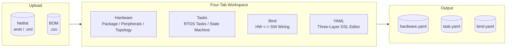
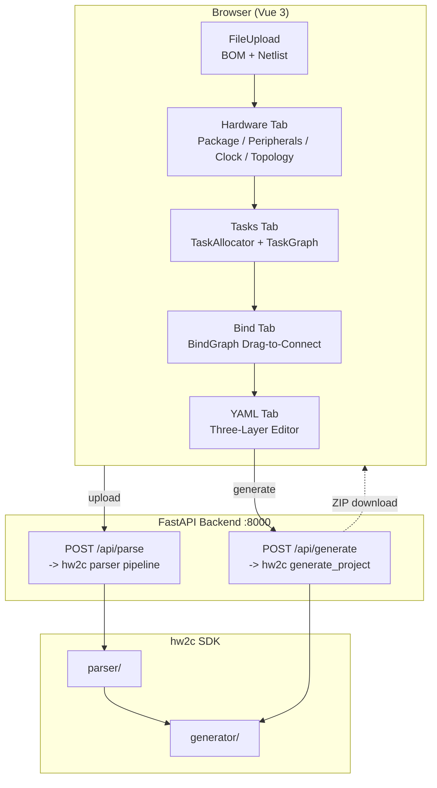

# hw2c-web

**Visual Configuration Frontend for hw2c** -- Upload EDA design files, preview the MCU package, orchestrate tasks and bindings, and generate embedded firmware with one click.

[](https://vuejs.org)
[](https://fastapi.tiangolo.com)
[](LICENSE)

---

## Feature Overview



> **One-liner**: Drag-and-drop hardware interrupt sources to FreeRTOS tasks, visually configure peripheral pins, and preview YAML output in real time.

---

## Four-Tab Workspace

| Tab | Contents | Technology |
|-----|----------|------------|
| **Hardware** | MCU package preview (LQFP64), pin usage status, peripheral list, clock tree, topology graph | Canvas rendering |
| **Tasks** | FreeRTOS task definitions (name/priority/stack), TaskGraph visualization, TaskAllocator CRUD | Vue Flow |
| **Bind** | Interrupt bindings (EXTI -> Task), peripheral assignment (Peripheral -> Task), task routing (Task -> Task) | Vue Flow drag-to-connect |
| **YAML** | `hardware.yaml` / `task.yaml` / `bind.yaml` three-pane CodeMirror editors | CodeMirror 6 |

---

## Tech Stack

| Layer | Technology | Notes |
|-------|-----------|-------|
| Frontend Framework | Vue 3 (Composition API + TypeScript) | Reactive state management |
| Flow Graph | Vue Flow | Task node visualization, drag-to-connect bindings |
| Code Editor | CodeMirror 6 | YAML syntax highlighting, dark theme |
| Backend | FastAPI (Python) | REST API, invokes hw2c parser/generator |
| Core Logic | hw2c SDK | Netlist parsing, code generation |

---

## Quick Start

### Prerequisites

- Python 3.10+ (hw2c installed: `pip install -e ../hw2c`)
- Node.js 18+
- Workspace layout:
  ```
  your-workspace/
  ├── hw2c/           # Core SDK
  └── hw2c-web/       # This repo
  ```

### 1. Start Backend

```bash
cd backend
pip install fastapi uvicorn
uvicorn app:app --reload --port 8000
```

### 2. Start Frontend

```bash
cd frontend
npm install
npm run dev
```

Open `http://localhost:5173` in your browser.

### 3. Workflow

1. Upload BOM + Netlist -> auto-detect hardware capabilities
2. Preview the MCU package and adjust peripheral config in the Hardware tab
3. Add FreeRTOS tasks in the Tasks tab
4. Drag to wire bindings in the Bind tab: EXTI -> Task, Peripheral -> Task, Task -> Task
5. Review/edit the generated DSL in the YAML tab
6. Click Generate to download the firmware ZIP

---

## API Endpoints

| Method | Path | Description |
|--------|------|-------------|
| `POST` | `/api/parse` | Upload netlist + BOM; returns `hardware_yaml` / `task_yaml` / `bind_yaml` and structured data |
| `POST` | `/api/generate` | Submit three-layer YAML; returns firmware ZIP download |
| `GET` | `/api/health` | Health check |

### `/api/parse` Request

```
multipart/form-data:
  netlist:  .enet or .xml  (str)
  bom:      .csv           (str, optional)
```

### `/api/parse` Response

```json
{
  "status": "ok",
  "mcu": { "part": "STM32G0B1RET6", "core": "Cortex-M0+", "ram_kb": 144, "flash_kb": 512, "dual_bank": true },
  "pins": [{"id": "PA0", "function": "GPIO_Input", "label": "BTN", "af": 0}],
  "peripherals": [{"name": "sensor", "type": "I2C", "bus": "I2C1"}],
  "hardware_yaml": "...",
  "task_yaml": "...",
  "bind_yaml": "...",
  "project": { "name": "untitled", "version": "0.1.0" },
  "bind": { "interrupt": [], "peripheral_assign": [], "routing": [] }
}
```

---

## Directory Structure

```
hw2c-web
├── backend/
│   ├── app.py              # FastAPI entry point
│   ├── schemas.py          # Pydantic request/response models
│   └── routes/
│       ├── parse.py        # POST /api/parse -- netlist parsing
│       └── generate.py     # POST /api/generate -- firmware generation
└── frontend/
    └── src/
        ├── App.vue         # Main layout (four tabs)
        ├── api.ts          # Backend API client
        ├── main.ts         # Entry point
        ├── composables/
        │   ├── useHardwareModel.ts  # hardware.yaml reactive model
        │   ├── useTaskModel.ts      # task.yaml reactive model
        │   ├── useBindModel.ts      # bind.yaml reactive model
        │   ├── ConstraintEngine.ts  # Pin constraint validation
        │   ├── BusColorMap.ts       # Bus color mapping
        │   └── Lqfp64Pinout.ts      # LQFP64 package coordinate data
        └── components/
            ├── FileUpload.vue       # File upload widget
            ├── PinChip.vue          # MCU package preview (Canvas)
            ├── PinTable.vue         # Pin detail table
            ├── PeripheralList.vue   # Peripheral list
            ├── PeripheralConfig.vue # Peripheral config panel
            ├── TopologyGraph.vue    # Hardware topology graph
            ├── ClockTree.vue        # Clock tree config
            ├── TaskAllocator.vue    # Task management panel
            ├── TaskGraph.vue        # Task structure graph
            ├── BindGraph.vue        # HW-SW binding graph
            ├── YamlEditor.vue       # CodeMirror YAML editor
            ├── YamlSource.vue       # YAML data source panel
            └── configs/
                ├── GPIOConfig.vue   # GPIO pin config
                ├── UARTConfig.vue   # UART peripheral config
                ├── SPIConfig.vue    # SPI peripheral config
                └── I2CConfig.vue    # I2C peripheral config
```

---

## Architecture



---

## Development

```bash
# Backend
cd backend && uvicorn app:app --reload --port 8000

# Frontend (Vite HMR)
cd frontend && npm run dev

# Type check
cd frontend && npx tsc --noEmit

# Production build
cd frontend && npm run build
```

---

## License

MIT (c) hw2c contributors
