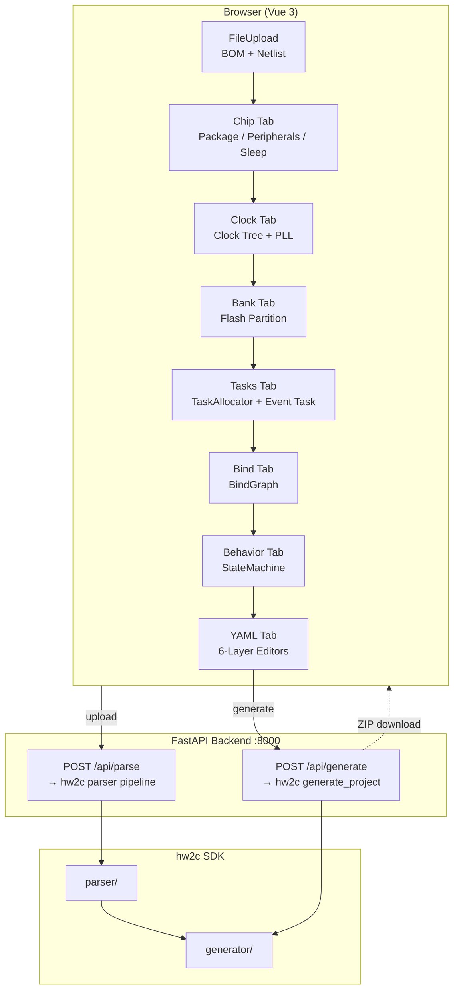

# hw2c-web

**Visual Configuration Frontend for hw2c** -- Upload EDA design files, preview the MCU package, orchestrate FreeRTOS tasks and HW/SW bindings, and generate embedded firmware with one click.

[](https://vuejs.org)
[](https://fastapi.tiangolo.com)
[](LICENSE)

[GitHub](https://github.com/jinliangliu/hw2c-web)

---

## Feature Overview

```mermaid
flowchart LR
    subgraph Input["Upload"]
        A1[("Netlist<br>.enet / .xml")]
        A2[("BOM<br>.csv")]
    end

    subgraph Tabs["7-Tab Workspace"]
        B1["Chip<br>Package / Peripherals"]
        B2["Clock<br>Clock Tree Config"]
        B3["Bank<br>Flash Partition"]
        B4["Tasks<br>FreeRTOS Tasks"]
        B5["Bind<br>HW ↔ SW Wiring"]
        B6["Behavior<br>State Machine"]
        B7["YAML<br>6-Layer DSL"]
    end

    subgraph Output["Output"]
        C1[("hardware.yaml")]
        C2[("task.yaml")]
        C3[("components.yaml")]
        C4[("bind.yaml")]
        C5[("params.yaml")]
        C6[("pubsub.yaml")]
    end

    Input --> Tabs --> Output
```



---

## Workspace Tabs

| Tab | Contents |
|-----|----------|
| **Chip** | LQFP64 MCU package preview with pin conflict validation, peripheral list with GPIO/EXTI highlighting, topology graph, sleep/low-power config |
| **Clock** | Editable clock tree: HSI/HSE/LSI/LSE sources, PLL M/N/R configuration, SYSCLK/APB prescalers, FreeRTOS tick source |
| **Bank** | Flash partition layout with dual-bank awareness, auto-default BOOT1/APP/BOOT2 partitions |
| **Tasks** | FreeRTOS task CRUD (name/entry/type/priority/stack), global Event Task dispatcher with configurable queue depth, heap size presets |
| **Bind** | Interrupt bindings (EXTI → Task), peripheral assignments (Peripheral → Task), task-to-task routing |
| **Behavior** | State machine editor for per-task behavior modeling |
| **YAML** | `hardware.yaml` / `task.yaml` / `components.yaml` / `bind.yaml` / `params.yaml` / `pubsub.yaml` six-pane CodeMirror editors, Ctrl+S download, Ctrl+G generate |

### Key Features

- **Real-time Pin Validation** -- detects AF conflicts and GPIO misuse as you assign functions
- **PDF Datasheet Viewer** -- click the MCU part number to open local datasheet/RM PDF with page memory (localStorage)
- **Inline Project Rename** -- click project name to rename, persisted to `task.yaml`
- **Event Task Dispatcher** -- global FreeRTOS task with configurable queue depth, collects timer/periodic/one-shot events and dispatches to app tasks
- **Flash Partition Editor** -- visual bank layout with automatic BOOT/APP defaults based on dual-bank config

---

## Tech Stack

| Layer | Technology | Notes |
|-------|-----------|-------|
| Frontend Framework | Vue 3 (Composition API + TypeScript) | Reactive state management |
| Flow Graph | Vue Flow | BindGraph drag-to-connect, StateMachine editor |
| Code Editor | CodeMirror 6 | YAML syntax highlighting, dark theme |
| Backend | FastAPI (Python) | REST API, invokes hw2c parser/generator |
| Core Logic | hw2c SDK | Netlist parsing, code generation |

---

## Quick Start

### Prerequisites

- Python 3.10+ (hw2c installed: `pip install -e ../hw2c`)
- Node.js 18+
- Backend automatically resolves the sibling hw2c checkout; set `HW2C_ROOT=/absolute/path/to/hw2c` if it lives elsewhere.
- Workspace layout:
  ```
  your-workspace/
  ├── hw2c/           # Core SDK
  └── hw2c-web/       # This repo
  ```

### 1. Start Backend

```bash
cd backend
pip install fastapi uvicorn python-multipart pyyaml
uvicorn app:app --reload --port 8000
```

### 2. Start Frontend

```bash
cd frontend
npm install
npm run dev
```

Open `http://localhost:5173` in your browser.

### 3. Workflow

1. Upload BOM + Netlist → auto-detect hardware capabilities
2. Preview MCU package, click part number for datasheet
3. Configure clock tree and flash partitions
4. Add FreeRTOS tasks, set heap size, configure Event Task queue depth
5. Wire bindings in the Bind tab: EXTI → Task, Peripheral → Task, Task → Task
6. Optionally define per-task state machine behavior
7. Review/edit DSL in the YAML tab
8. Click Generate or Ctrl+G to download firmware ZIP

## Deployment Model

hw2c-web is a local/self-hosted technical tool. Run the FastAPI backend and
Vite frontend together; the backend must have access to an hw2c checkout and
its vendored submodules.

The GitHub Pages workflow builds only the frontend as a static preview.
`/api/*` is not available in that static deployment, so firmware generation
must be done locally or against your own self-hosted backend.

---

## API Endpoints

| Method | Path | Description |
|--------|------|-------------|
| `POST` | `/api/parse` | Upload netlist + BOM; returns structured data plus six-layer YAML with minimal components/params/pubsub defaults |
| `POST` | `/api/generate` | Submit six-layer YAML; returns firmware ZIP |
| `GET` | `/api/health` | Health check |

### `/api/parse` Request

```
multipart/form-data:
  netlist:  .enet or .xml  (required)
  bom:      .csv           (optional)
```

### `/api/parse` Response

```json
{
  "status": "ok",
  "mcu": { "part": "STM32G0B1RET6", "core": "Cortex-M0+", "core_clock_mhz": 64, "ram_kb": 144, "flash_kb": 512, "dual_bank": true },
  "pins": [{"id": "PA0", "function": "GPIO_Input", "label": "BTN", "af": 0}],
  "peripherals": [{"name": "sensor", "type": "I2C", "bus": "I2C1"}],
  "clock": { "sysclk": { "source": "HSE_PLL", "frequency_hz": 64000000 } },
  "hardware_yaml": "...",
  "task_yaml": "...",
  "components_yaml": "...",
  "bind_yaml": "...",
  "params_yaml": "...",
  "pubsub_yaml": "...",
  "project": { "name": "untitled", "version": "0.1.0" },
  "bind": { "interrupt": [], "peripheral_assign": [], "routing": [] }
}
```

---

## Six-Layer YAML DSL

hw2c v0.4.0 uses six configuration layers. The web UI currently has structured editors for `hardware.yaml`, `task.yaml`, and `bind.yaml`; `components.yaml`, `params.yaml`, and `pubsub.yaml` are editable as raw YAML in the YAML tab.

### `task.yaml` (project + event task + behavior + periodic events)

```yaml
project:
  name: my_project
  version: '0.1.0'
  heap_size: 24576

event_task:
  name: events_process_task
  entry: vEventTask
  priority: 3
  stack_size: 512
  queue_depth: 16

behavior:
  initial_state: IDLE
  states:
    - name: IDLE
      transitions:
        - event: SENSOR_READY
          target: ACTIVE

periodic_events:
  - event: SECONDS_30
    actions:
      - telemetry_snapshot
```

### `components.yaml` (component registry)

```yaml
components:
  - name: led
    type: led
    driver: gpio
    period_ms: 50
    sleep_compat: STOP1
    config:
      default_pattern: off
```

### `params.yaml` (runtime parameters)

```yaml
params:
  - name: led_brightness
    component: shell
    type: uint32
    default: 200
    min: 0
    max: 255
```

### `pubsub.yaml` (component event bus)

```yaml
topics:
  - name: led_state
    description: "LED on/off state change"
    value: { type: uint32, unit: "0/1" }
```

### `bind.yaml` (HW ↔ SW wiring)

```yaml
hardware: hardware.yaml
task: task.yaml
interrupt:
  - pin: PB0
    task: sensor_read
    event: EXTI0_IRQ
peripheral_assign:
  - peripheral: uart_debug
    task: sensor_read
    role: owner
routing:
  - from: sensor_read
    to: data_logger
    signal: sensor_data_ready
```

---

## Directory Structure

```
hw2c-web
├── backend/
│   ├── app.py              # FastAPI entry point
│   ├── schemas.py          # Pydantic request/response models
│   └── routes/
│       ├── parse.py        # POST /api/parse
│       └── generate.py     # POST /api/generate
└── frontend/
    └── src/
        ├── App.vue         # Main layout (7 tabs)
        ├── api.ts          # Backend API client
        ├── main.ts         # Entry point
        ├── data/
        │   └── mcu/
        │       └── STM32G0B1RE.json   # MCU pin definitions
        ├── composables/
        │   ├── useHardwareModel.ts     # hardware.yaml reactive model
        │   ├── useTaskModel.ts         # task.yaml reactive model
        │   ├── useBindModel.ts         # bind.yaml reactive model
        │   ├── ConstraintEngine.ts     # Pin conflict validation
        │   ├── BusColorMap.ts          # Bus color mapping
        │   ├── Lqfp64Pinout.ts         # LQFP64 package coordinates
        │   └── useMcudoc.ts            # Datasheet PDF URL resolver
        └── components/
            ├── FileUpload.vue          # File upload widget
            ├── PinChip.vue             # MCU package preview (Canvas)
            ├── PinTable.vue            # Pin detail table
            ├── PinAfSelector.vue       # Pin alternate-function picker
            ├── PeripheralList.vue      # Peripheral list (GPIO/EXTI)
            ├── PeripheralConfig.vue    # Peripheral config panel
            ├── TopologyGraph.vue       # Hardware topology graph
            ├── ClockTree.vue           # Editable clock tree + PLL
            ├── BankPartition.vue       # Flash partition layout
            ├── SleepConfig.vue         # Low-power mode config
            ├── TaskAllocator.vue       # FreeRTOS task + event task config
            ├── BindGraph.vue           # HW-SW binding graph
            ├── StateMachineEditor.vue  # State machine behavior editor
            ├── YamlEditor.vue          # CodeMirror YAML editor
            ├── YamlSource.vue          # YAML data source panel
            ├── PdfViewer.vue           # Datasheet/RM PDF viewer
            └── configs/
                ├── GPIOConfig.vue      # GPIO pin config
                ├── UARTConfig.vue      # UART peripheral config
                ├── SPIConfig.vue       # SPI peripheral config
                └── I2CConfig.vue       # I2C peripheral config
```

---

## Architecture



---

## Development

```bash
# Backend
cd backend && uvicorn app:app --reload --port 8000

# Frontend (Vite HMR)
cd frontend && npm run dev

# Type check
cd frontend && npx vue-tsc --noEmit

# Production build
cd frontend && npm run build
```

---

## Local MCP Connector (WorkBuddy)

The `connector/local` package runs as a **local stdio process** — no network port,
no token, no marketplace publish. It exposes parse/validate/examples/resources plus
an async `generate_firmware` → `get_build_status` → `list_artifacts` flow that
delivers `.elf`/`.bin` with size and sha256.

```bash
# 1) generate connector/local/mcp.json with THIS machine's absolute paths
python connector/local/install.py                       # flash tools disabled (default)
python connector/local/install.py --enable-flash        # opt in to list_probes/flash_firmware/
                                                        # verify_flash/capture_serial
# 2) install connector/local as a local Connector in WorkBuddy
```

`--enable-flash` requires pyOCD on PATH and an interpreter that can `import pyocd`;
the installer writes `HW2C_PYOCD` / `HW2C_PYOCD_PYTHON` into the generated (gitignored)
`mcp.json`. Hardware tools are **not registered** without it. Even when registered,
`flash_firmware` only returns a dry-run plan unless `confirm` is the literal boolean
`true`; it sector-erases only the target range, reads back before and after writing,
and leaves the core halted (no automatic reset).

Contract guardrails: `python backend/tests/test_mcp_contract.py` and
`python backend/tests/mutate_mcp_contract.py` (run with an interpreter that has the
MCP SDK installed; both have a stdlib runner fallback for pytest-less environments).
